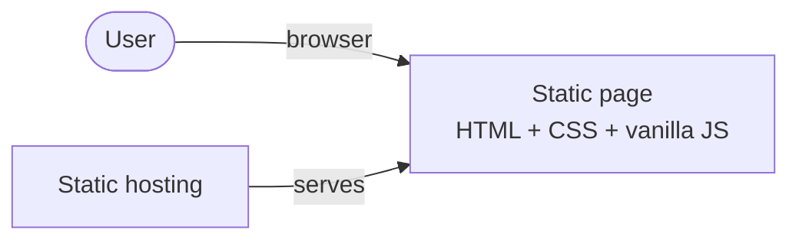
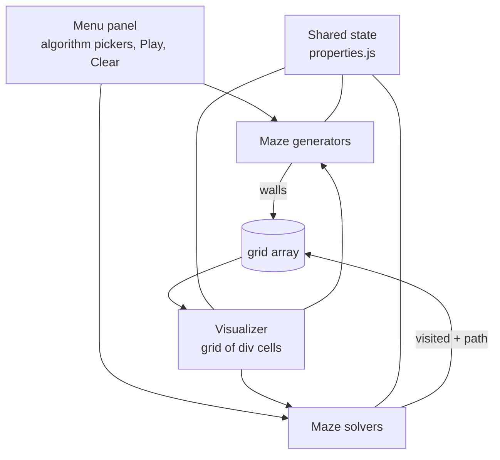

# Maze Solver: High-Level Design

An interactive page that generates mazes with six algorithms and solves them with five path-finding algorithms, animating every step. Live at [maze.minianon.in](https://maze.minianon.in). Based on [Maze_solver by Angel Uriot](https://github.com/angeluriot/Maze_solver) (MIT). For code-level detail see the [Low-Level Design](lld.md).

## 1. System context

Everything runs in the browser. There is no build step, backend or external API.

## 2. Components

| Component | Responsibility |
|---|---|
| Visualizer | Sizes the grid to the window, draws cells, handles drawing walls and dragging start / target |
| Maze generators | Build a maze into the grid and animate the walls appearing |
| Maze solvers | Search from start to target, then animate visited cells and the final path |
| Menu | Generator and solver dropdowns, Play and Clear buttons |
| Shared state | Grid, positions, animation lists and flags used by all modules |

## 3. Algorithms

| Generators | Solvers |
|---|---|
| Randomized depth-first | Breadth-first |
| Kruskal's | Bidirectional breadth-first |
| Prim's | Greedy best-first |
| Wilson's | Dijkstra (same as BFS on this unweighted grid) |
| Aldous-Broder | A* |
| Recursive division | |
| Custom (draw walls by hand) | |

## 4. Tech stack

| Layer | Choice |
|---|---|
| Markup and style | HTML5, CSS (`grid.css`, `menu.css`, `style.css`) |
| Logic | Vanilla JavaScript in strict mode, split into six scripts |
| Rendering | One `div` per cell, styled by CSS classes |

## 5. Quality attributes

| Attribute | Approach |
|---|---|
| Teaching value | Every visited cell and the final path are animated in order |
| Responsiveness | Grid size and cell size are computed from the window; resizing clears the grid |
| Simplicity | No dependencies; each concern lives in its own script |
| Known limits | Shared global state; the grid is limited to about 47 cells on its long side |
