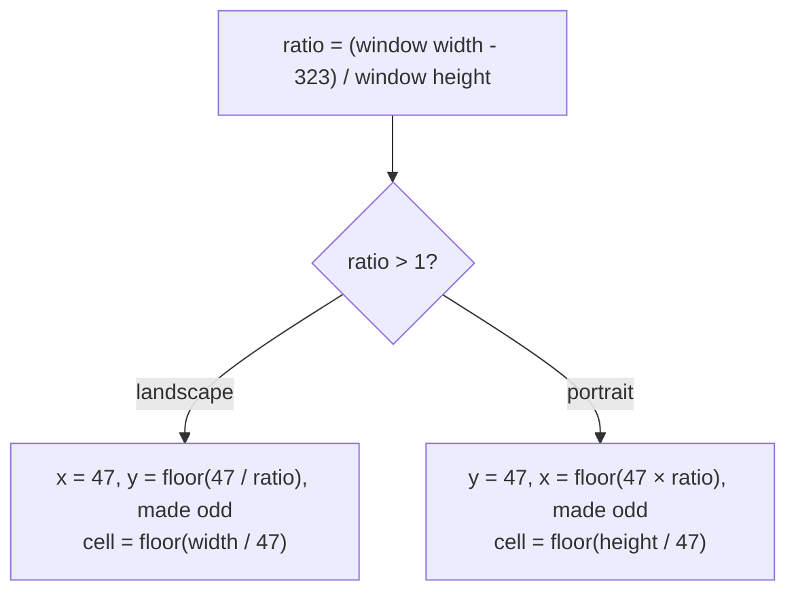
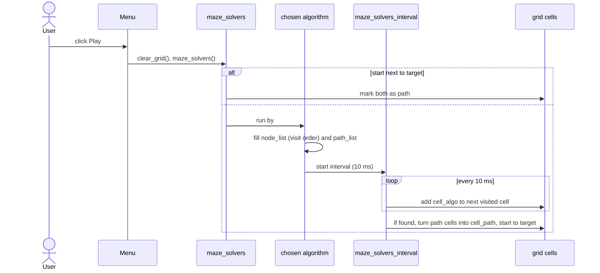

# Maze Solver: Low-Level Design

Scripts, shared state, grid encoding and the animation loop. For the big picture see the [High-Level Design](hld.md).

## 1. Scripts

| File | Key functions |
|---|---|
| `js/properties.js` | Shared state (below), `initial_max_grid_size = 47`, `menu_width = 323` |
| `js/visualizer.js` | `set_grid_properties`, `generate_grid`, `delete_grid`, `cell_to_place`, `place_to_cell`, `add_wall`, `remove_wall`, `clear_grid`, `get_node`, `click_event`, `visualizer_event_listeners` |
| `js/maze_generators.js` | `get_neighbours`, `fill`, `fill_walls`, `enclose`, `randomized_depth_first`, `kruskal_algorithm`, `prim_algorithm`, `wilson_algorithm`, `aldous_broder_algorithm`, `recursive_division`, `maze_generators` |
| `js/maze_solvers.js` | `distance`, `maze_solvers_interval`, `breadth_first`, `bidirectional_breadth_first`, `greedy_best_first`, `dijkstra`, `a_star`, `maze_solvers` |
| `js/menu.js` | `hidden_clear`, `clear`, `menu_event_listeners` |
| `js/script.js` | `window.onload`: layout, grid, listeners; clears on resize |

## 2. Shared state

| Variable | Meaning |
|---|---|
| `grid` | 2D array of cells: `-1` wall, `0` free; solvers write visit marks / costs |
| `grid_size_x`, `grid_size_y`, `cell_size` | Grid dimensions and pixel size per cell |
| `start_pos`, `target_pos` | `[x, y]` of start and target |
| `clicking`, `moving_start`, `moving_target` | Mouse interaction state |
| `node_list`, `node_list_index` | Visited cells in order, for animation |
| `path_list`, `path_list_index` | Final path cells, for animation |
| `found`, `path` | Whether the target was reached; whether the path phase has started |
| `generating`, `timeouts` | Maze generation in progress, and its pending wall timeouts |
| `grid_clean`, `my_interval` | Whether the grid is clean; the solver animation timer |

## 3. Grid sizing

Odd dimensions let generators place walls on even rows and columns and passages on odd ones; `maze_generators()` also nudges start and target onto odd cells.

## 4. Solve and animate

The search runs fully first; only the drawing is animated, so speed does not depend on the algorithm's cost.

## 5. Algorithms

| Solver | Frontier rule |
|---|---|
| Breadth-first | FIFO queue |
| Bidirectional BFS | Two BFS waves from start and target until they meet |
| Greedy best-first | Sort frontier by straight-line `distance` to target |
| Dijkstra | Calls BFS (all moves cost 1) |
| A* | Cost so far + straight-line distance, with a `cost_grid` |

| Generator (`#slct_2`) | Idea |
|---|---|
| 1 Randomized depth-first | Carve passages with a random DFS from a cell |
| 2 Kruskal's | Join random cells while avoiding cycles |
| 3 Prim's | Grow the maze from a frontier of walls |
| 4 Wilson's | Loop-erased random walks, unbiased maze |
| 5 Aldous-Broder | Random walk until every cell is visited |
| 6 Recursive division | Split chambers with walls that have one gap; walls appear via `setTimeout` |

## 6. Interaction

| Input | Effect |
|---|---|
| Click / drag on empty cells | Draw or erase walls (generator switches to "Custom") |
| Drag start or target | Move it; a wall under it is removed |
| Change generator | Generates a new maze immediately |
| Clear | Clears walls and results, keeps start and target |
| Window resize | Clears the grid |
